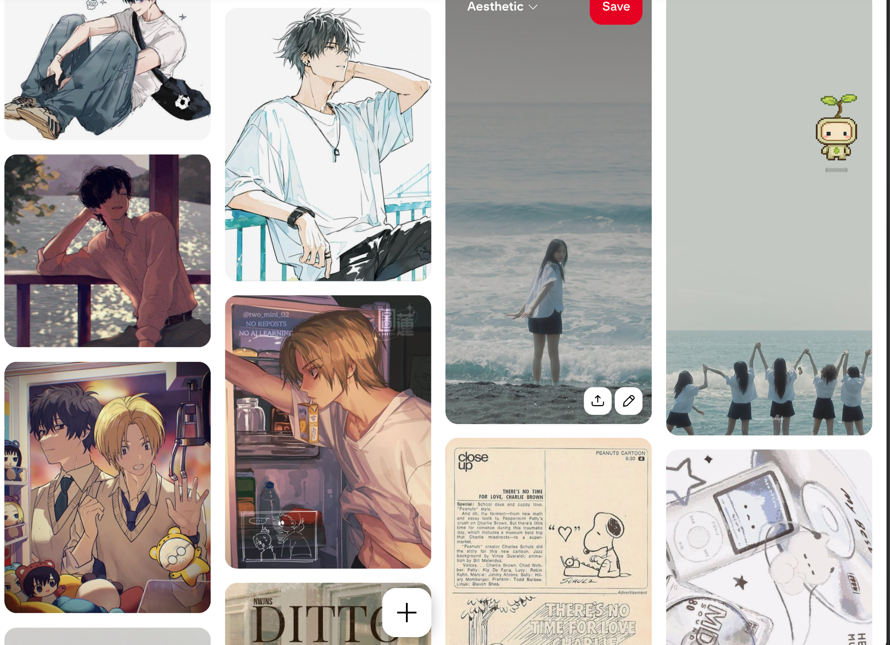
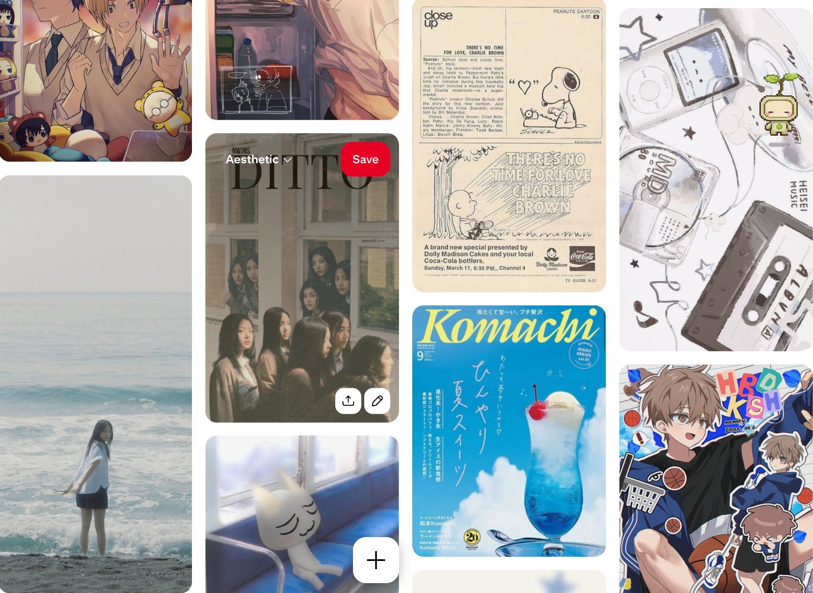
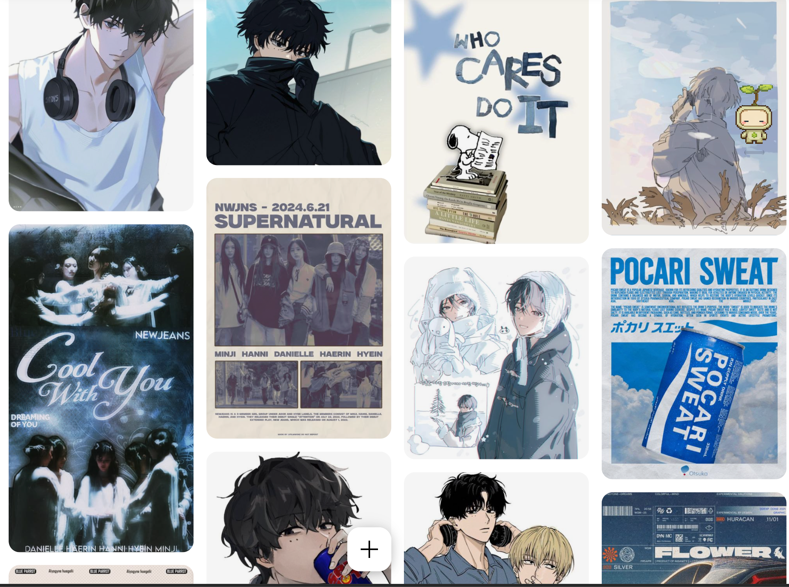
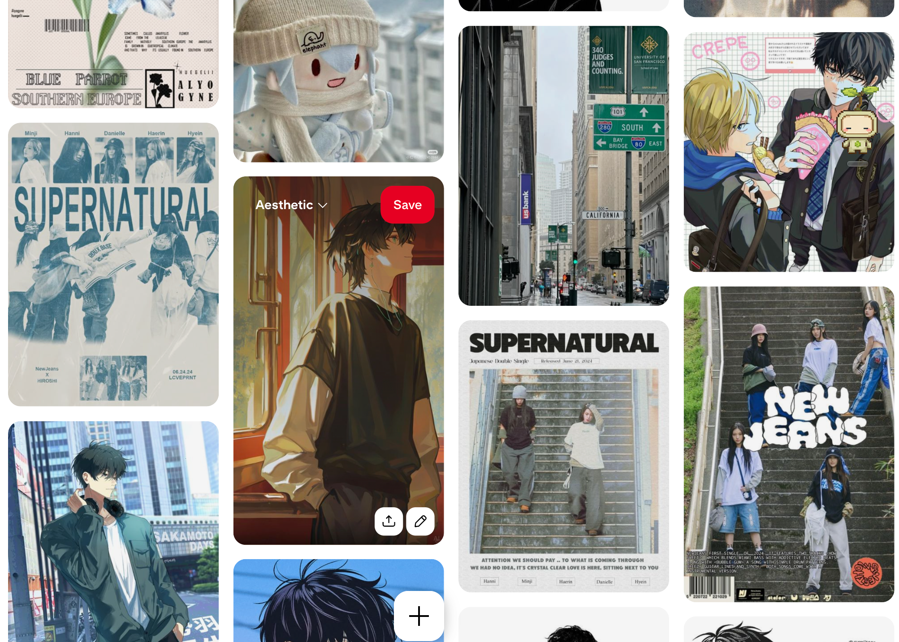
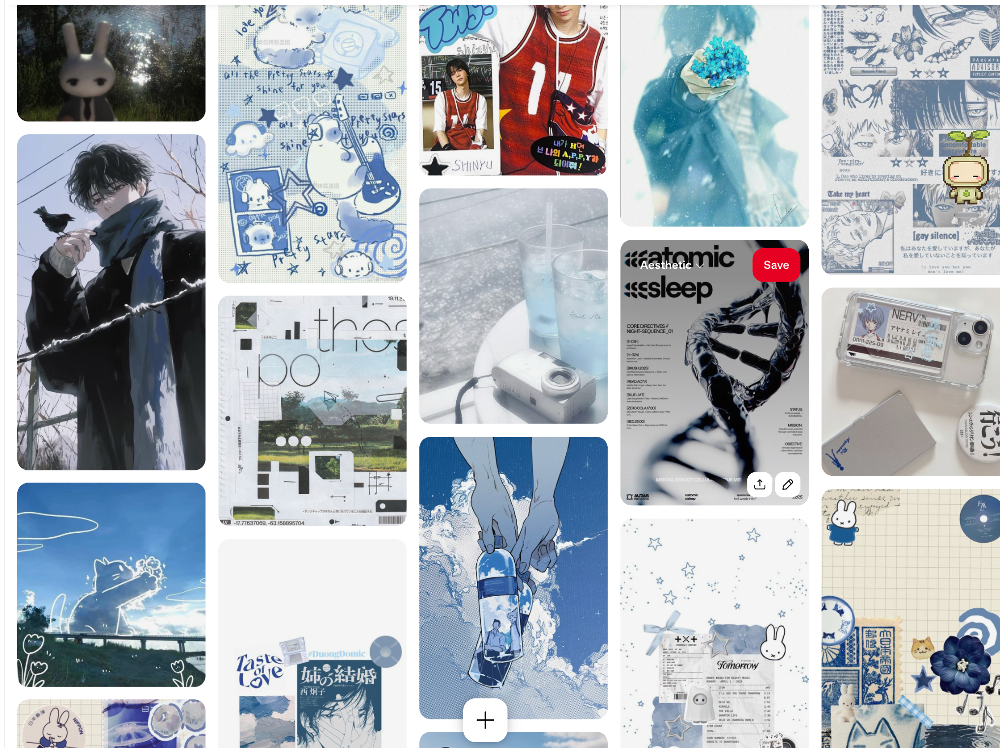
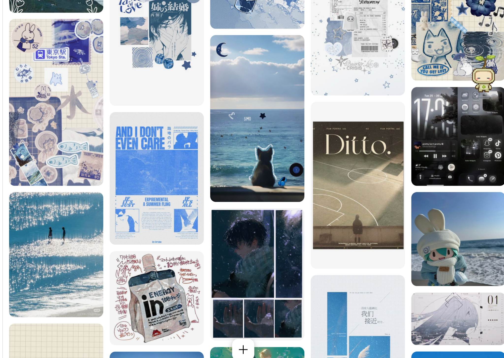
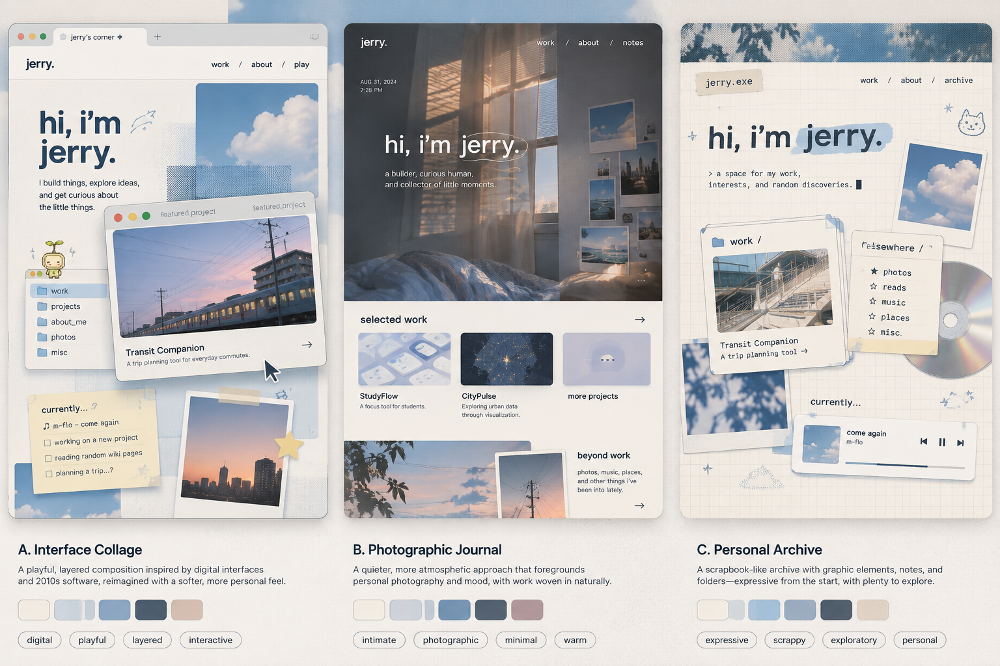

# Visual reference gallery

This gallery accompanies the [creative brief](design/creative-brief.md). It preserves **all six uploaded Pinterest screenshots** and the **original generated homepage comparison**, replacing the misaligned crops in the prepared ZIP. Click an image for full resolution. Locations below refer to the image as displayed, left to right.

**Current preference:** Jerry prefers A (Interface Collage) and C (Personal Archive), with a likely combination. See [current direction](design/direction.md) for decisions made after these mockups.

## Sources and interpretation

- [Source design conversation](https://chatgpt.com/c/6aebb2f8-d6e4-83ea-bb80-567059082497) — access may require the owner's account.
- [Pinterest collection shared by the owner](https://pin.it/69QxN7ZEQ) — the shortlink could not be independently resolved during review; this is a supplied source clue, not a verified pin list.
- [Source manifest](references/manifest.json) — dimensions, checksums, provenance, and explicit unknowns.

The screenshots establish what was shared, not authorship or permission. Visible titles and watermarks are clues, not verified creator attribution. No individual pin or creator URLs have been invented. Study notes are interpretations, not new requirements or approved website copy.

## P01 — Sea memories and casual illustration

- **Primary study:** Third-column beach photograph: a small figure against pale sea and sky, hazy blue-grey colour, quiet distance, and intimate summer atmosphere.
- **Supporting study:** Relaxed poses in the first two columns and group by the water at right. Borrow softness, framing, and ease without making literal anime or a pop group the site's identity.
- **Quality/context:** 2028 × 1472. Pins are clipped at screenshot edges; Pinterest hover controls and a small desktop-pet overlay are part of the supplied image.

## P02 — Muted pop editorial and blue summer print

- **Primary study:** Second-column *Ditto* composition: subdued group photography, large serif title, and faded warmth. Study atmosphere and type/image relationships without copying artist identity.
- **Supporting study:** Third-column blue *Komachi* cover with a summer drink: selective saturation, scale, sky, and print hierarchy. The Peanuts advertisement above offers warm-paper contrast.
- **Quality/context:** 1974 × 1442. The sea pin overlaps P01 intentionally as the board scrolls. Hover controls obscure part of the *Ditto* pin.

## P03 — Blue advertising, editorial, and cool illustration

- **Primary study:** Right-column *Pocari Sweat* graphic: strong blue, large type, clouds, and a clear focal object. This is distinct from P02's *Komachi* cover.
- **Supporting study:** Second-column *Supernatural* poster and left-column *Cool With You* composition: muted blue-grey editorial treatments versus the brighter advertisement.
- **Illustration study:** Top-left white-shirt/headphones figure: cool shadows and relaxed framing. Its head is clipped in the uploaded screenshot; no complete artwork is claimed.
- **Quality/context:** 2006 × 1494. A desktop-pet overlay covers part of the top-right illustration, leaving the beverage graphic visible.

## P04 — Blue print composition and everyday city photography

- **Primary study:** Left-column blue-on-cream *Supernatural* composition: photo cutouts, typographic hierarchy, and printed texture.
- **Photography study:** Third-column San Francisco street, with a California Street sign: ordinary urban scale, depth, and lived-in surroundings. This is a **daytime street image**, correcting the old evening-street filename.
- **Atmosphere study:** Second-column window-lit illustration: warm light contrasting with cool photography, supporting bedroom intimacy without requiring character art.
- **Quality/context:** 2006 × 1434. Street imagery is clear; hover controls cover part of the adjacent illustration.

## P05 — Blue collage, quiet objects, and graphic intensity

- **Primary study:** Second-column blue-on-cream sticker collage at top: small marks, layered scraps, and a limited colour family. Its upper edge is clipped in the source screenshot.
- **Supporting study:** Camera and pale drinks in the central column, and nature/paper composition beneath the stickers: quieter alternatives to character-led imagery.
- **Range check:** Darker figures and monochrome graphics show the board is not uniformly pastel or cute. Their intensity is a comparison point, not a new requirement.
- **Quality/context:** 2034 × 1522. Complete context preserves the balance between object photography, collage, and denser graphics.

## P06 — Complete collage, sparkling water, and personal archiving

- **Primary study:** Left-column blue stationery collage and sparkling water image below it. The water image has **two small figures and bright reflections**, not the energy-drink pouch shown by the old crop.
- **Supporting study:** Second-column blue typographic poster and central sea/sky collage: expressive arrangements with a restrained colour family.
- **Boundary check:** Music, phone-screen, CD, and sticker motifs are optional influences. They do not establish a literal OS clone, music-player identity, or personal history.
- **Quality/context:** 2048 × 1458. Some pins continue from P05. These are screenshot-resolution references, not original artwork masters.

## G01 — Three generated homepage concepts

Generated in the source ChatGPT conversation in response to “can you create a few drafts of what it could look like?” **AI-generated concept work, not a Pinterest screenshot.** Original downloaded resolution: 1536 × 1024, replacing the ZIP's 1100 × 733 WebP preview.

| Concept | Useful qualities | Tension to resolve |
| --- | --- | --- |
| A — Interface Collage | Varied panels, layering, visible featured work, tactile digital character | Browser chrome and folders can become too literal an OS imitation |
| B — Photographic Journal | Intimacy, dusk light, quiet type, photographic warmth | Large hero can crowd out work or become too minimal |
| C — Personal Archive | Discoverable collections, imperfect placement, playful composition | Tape, CDs, players, and decorative scraps can feel manufactured |

No concept has been selected. Project titles, dates, locations, labels, and personal notes are illustrative placeholders, not verified biographical facts. The [brief](design/creative-brief.md) records the tradeoffs and proposed synthesis.

## What to carry into the website

1. Intimate nostalgia and human warmth, with summer memory as an undertone.
2. Quiet, approachable typography paired with expressive composition.
3. Muted blues and warm neutrals, with selective stronger accents; exact colours remain open.
4. Fast tactile interactions and optional discoveries while projects stay easy to find.
5. Authentic photos and content, with selective graphic scraps that serve a purpose.

## Reuse limits

Pinterest imagery remains third-party reference material with unverified creators, pin URLs, and licenses. These files are not a production asset library. The generated comparison does not clear recognizable third-party motifs it depicts. Preserve attribution status if files move or are reused. See the [review record](archive/reference-package-review.md) for defects and verification scope.
